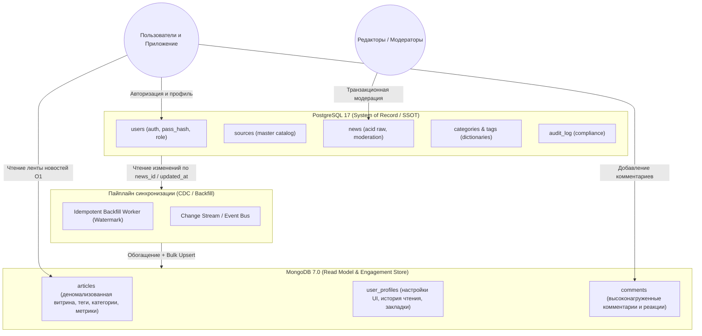
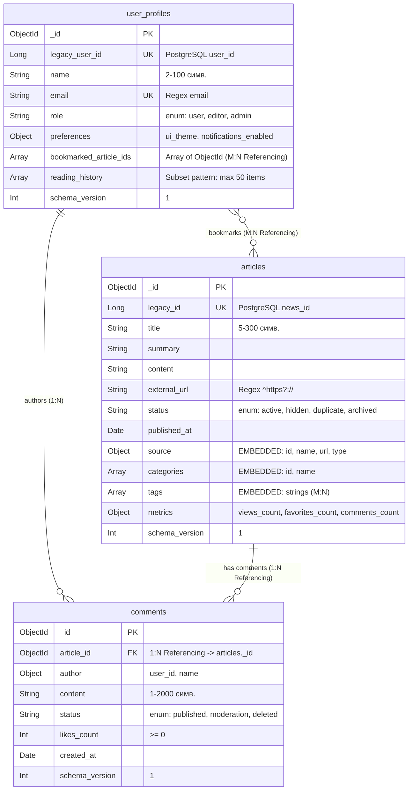

# 🏛️ Журнал архитектурных решений (ADR) — Спринт 5

**Тема:** Расширенный SQL (PostgreSQL) и документная модель данных (MongoDB)  
**Проект:** Высоконагруженный новостной агрегатор  
**Статус:** Принято к реализации (Accepted)  
**Контекст:** Разделение зон ответственности реляционной и документной СУБД (Polyglot Persistence), аналитические витрины, высокопроизводительная отдача ленты новостей, интерактивные комментарии и идемпотентный перенос данных.

---

## 📑 Содержание

1. [Каталог аналитических SQL-запросов (PostgreSQL)](#1-каталог-аналитических-sql-запросов-postgresql)
2. [Модель владения данными и источник истины (SSOT)](#2-модель-владения-данными-и-источник-истины-ssot)
3. [Задачи с преимуществом документной модели](#3-задачи-с-преимуществом-документной-модели)
4. [Диаграмма и спецификация коллекций MongoDB](#4-диаграмма-и-спецификация-коллекций-mongodb)
5. [Архитектурное решение: Embedding vs Referencing](#5-архитектурное-решение-embedding-vs-referencing)
6. [Словарь коллекций и полей (Data Dictionary) — Желательно №2](#6-словарь-коллекций-и-полей-data-dictionary)
7. [Настройки Schema Validation ($jsonSchema) и CRUD-сценарии](#7-настройки-schema-validation-jsonschema-и-crud-сценарии)
8. [Воспроизводимый Backfill из PostgreSQL в MongoDB — Восхитительно](#8-воспроизводимый-backfill-из-postgresql-в-mongodb)
9. [Сравнение JSONB в PostgreSQL и отдельной коллекции MongoDB](#9-сравнение-jsonb-в-postgresql-и-отдельной-коллекции-mongodb)
10. [Стратегия версионирования схемы (Schema Versioning Pattern)](#10-стратегия-версионирования-схемы-schema-versioning-pattern)
11. [Полнотекстовый поиск в PostgreSQL и его ограничения — Желательно №3](#11-полнотекстовый-поиск-в-postgresql-и-его-ограничения)

---

## 1. Каталог аналитических SQL-запросов (PostgreSQL)

В реляционном ядре PostgreSQL сформирован каталог из 8 содержательных бизнес-запросов ([`scripts/advanced_sql_queries.sql`](file:///mnt/c/Users/PC/OneDrive/Desktop/SQL/scripts/advanced_sql_queries.sql)), полностью покрывающий все требования ТЗ:

| № | Название и бизнес-смысл | Тип аналитики | Конструкции SQL | Используемые таблицы |
|---|---|---|---|---|
| **1** | **Персональная лента новостей**<br>Формирование 20 активных публикаций по подпискам пользователя | Рекомендация контента | `JOIN`, `WHERE`, `ORDER BY`, `LIMIT` | `news`, `sources`, `news_categories`, `subscriptions` (4 таблицы) |
| **2** | **Аналитика активности источников**<br>Поиск самых продуктивных контент-партнеров (> 1000 публикаций) | Агрегатная аналитика | `JOIN`, `COUNT`, `GROUP BY`, `HAVING` | `sources`, `news` (2 таблицы) |
| **3** | **Популярные темы (Облако тегов)**<br>Топ-10 самых частотных тегов в активных статьях | Агрегатная аналитика | `JOIN`, `COUNT`, `GROUP BY`, `ORDER BY` | `tags`, `news_tags`, `news` (3 таблицы) |
| **4** | **Мониторинг спама и дубликатов**<br>Источники с аномальным числом дубликатов (> 100) для штрафов | Модерация и качество | `JOIN`, `COUNT`, `GROUP BY`, `HAVING` | `sources`, `news` (2 таблицы) |
| **5** | **Рейтинг вовлеченности пользователей**<br>Топ-5 пользователей по числу закладок в избранном | Программа лояльности | `JOIN`, `COUNT`, `GROUP BY`, `ORDER BY` | `users`, `favorites` (2 таблицы) |
| **6** | **Топ-3 свежих новостей по каждой рубрике**<br>Дашборд рубрик на главной витрине портала | **Оконная: Ранжирование** | `DENSE_RANK() OVER (PARTITION BY ... ORDER BY ...)`, `CTE` | `categories`, `news_categories`, `news` (3 таблицы) |
| **7** | **Анализ периодичности публикаций источников**<br>Расчет интервала времени (дельта в минутах) между новостями | **Оконная: Смещение (LAG)** | `LAG() OVER (PARTITION BY ... ORDER BY ...)`, `CTE`, `EPOCH` | `sources`, `news` (2 таблицы) |
| **8** | **Динамика публикаций: Running Total & Moving Average**<br>Накопительный объем новостей и 3-дневное скользящее среднее | **Накопительный и скользящий агрегат** | `SUM(...) OVER (ROWS UNBOUNDED PRECEDING)`, `AVG(...) OVER (ROWS 2 PRECEDING)`, `CTE` | `sources`, `news` (2 таблицы) |

*Автоматическая валидация всех 8 запросов реализована в скрипте [`scripts/test_advanced_sql.py`](file:///mnt/c/Users/PC/OneDrive/Desktop/SQL/scripts/test_advanced_sql.py) (21 из 21 проверки PASS).*

---

## 2. Модель владения данными и источник истины (SSOT)

В архитектуре новостного агрегатора применяется паттерн **Polyglot Persistence (многовариантное хранение)**:



### Разделение ответственности:

1. **PostgreSQL — Источник истины (Single Source of Truth, SSOT):**
   - **Доменные сущности:** Учетные записи (`users`), хэши паролей, роли, системные ограничения, мастер-справочники (`sources`, `categories`, `tags`).
   - **Жизненный цикл новостей:** Первичная загрузка сырых статей парсерами, транзакционная дедупликация, ручная модерация редакторами (статусы: `hidden`, `active`, `duplicate`, `archived`).
   - **Свойства:** Строгие ACID-транзакции, ссылочная целостность (Foreign Keys), Row-Level Security (RLS).

2. **MongoDB — Витрина быстрого чтения и интерактивности (Read Model):**
   - **Доменные сущности:**
     - `articles` — агрегированные денормализованные документы новостей, готовые для отдачи в API/мобильные приложения за 1 чтение.
     - `user_profiles` — профили пользователей, персональные предпочтения тем оформления, ограниченная история чтения (Subset Pattern).
     - `comments` — древовидные и линейные комментарии пользователей, реакции и лайки.
   - **Свойства:** Высокая скорость чтения и записи, отсутствие тяжелых JOIN, гибкость схемы, горизонтальная масштабируемость.

---

## 3. Задачи с преимуществом документной модели

Документная модель MongoDB выбрана для следующих ключевых бизнес-сценариев:

1. **Высоконагруженная лента новостей (Read-Heavy Newsfeed):**
   - *В PostgreSQL:* Чтобы отдать одну страницу ленты новостей, требуется соединить 4 таблицы (`news`, `sources`, `news_categories`, `tags`). На миллионных объемах это приводит к сотням случайных дисковых чтений.
   - *В MongoDB:* Документ статьи содержит внутри метаданные источника и массив тегов (`Embedding`). Выборка выполняется за **$O(1)$** чтение по индексу без единого JOIN.
2. **Полиморфные интерактивные данные (User Engagement & Comments):**
   - Комментарии и реакции имеют динамическую природу (текстовый комментарий, реакция-эмодзи, ветка ответов, системная отметка модерации). Реляционная модель требует множества разреженных таблиц. В MongoDB это естественный BSON-документ.
3. **Хранение истории чтения (Subset Pattern):**
   - Фиксация последних 50 прочитанных статей с временем просмотра прямо внутри документа профиля пользователя исключает необходимость создания гигантской связующей таблицы на сотни миллионов строк.

---

## 4. Диаграмма и спецификация коллекций MongoDB



---

## 5. Архитектурное решение: Embedding vs Referencing

| Сценарий связи | Выбранное решение | Обоснование через характер чтения | Обоснование через характер обновления | Обоснование через размер документа |
|---|:---:|---|---|---|
| **Статья ↔ Теги (M:N)** | **Embedding** (Встраивание массива строк) | Теги **всегда** запрашиваются вместе с новостью для рендеринга тегов на карточке. Встраивание дает выборку за 1 чтение без `$lookup`. | Теги назначаются 1 раз при публикации и практически **никогда не меняются**. Отсутствует проблема рассинхронизации. | Тегов у статьи от 2 до 10 штук. Размер массива составляет менее **300 байт**, что абсолютно безопасно для лимита 16 MB. |
| **Статья ↔ Источник (1:N)** | **Embedding** (Встраивание объекта `source`) | Имя и тип источника отображаются в шапке каждой новости. Исключает отдельное чтение каталога источников. | Источники обновляют название крайне редко (раз в несколько лет). | Добавляет к документу всего **~100 байт**. |
| **Статья ↔ Комментарии (1:N)** | **Referencing** (Ссылка `article_id` в `comments`) | Статьи в ленте читаются в сотни раз чаще, чем комментарии. Загрузка сотен комментариев замедлила бы ленту. | Комментарии пишутся непрерывно тысячами пользователей. Встраивание вызывало бы блокировки документа статьи. | **Unbounded 1:N**: У вирусной новости могут быть 100 000+ комментариев. Встраивание **гарантированно пробило бы лимит BSON 16 MB**. |
| **Пользователи ↔ Закладки (M:N)** | **Referencing** (Массив `bookmarked_article_ids`) | Пользователь открывает список закладок в личном кабинете. Достаточно легкого массива `ObjectId`. | Добавление/удаление закладки выполняется атомарным оператором `$addToSet` / `$pull` без изменения статьи. | Размер массива `ObjectId` (12 байт каждый) даже для 1000 закладок занимает всего **12 КБ**. |

---

## 6. Словарь коллекций и полей (Data Dictionary) — Желательно №2

### 6.1. Коллекция `articles`

| Поле | BSON Тип | Обязательное | Индекс | Описание и бизнес-правила | Пример значения |
|---|---|:---:|:---:|---|---|
| `_id` | `objectId` | Да | Primary (1) | Уникальный идентификатор документа MongoDB | `ObjectId("6afc1be66028672f9a89ce70")` |
| `legacy_id` | `long` / `int` | Нет | Unique (1) | Идентификатор `news_id` из PostgreSQL для идемпотентности | `NumberLong("1015270")` |
| `title` | `string` | **Да** | Text | Заголовок новости. Валидация: `minLength: 5, maxLength: 300` | `"Вышел релиз PostgreSQL 17"` |
| `summary` | `string` / `null` | Нет | — | Краткое резюме (аннотация) публикации | `"Основные новшества: вакуум, JSON..."` |
| `content` | `string` / `null` | Нет | Text | Полный текст статьи | `"Текст статьи подробно..."` |
| `external_url` | `string` | Нет | — | URL оригинала. Валидация: Regex `^https?://.+` | `"https://postgresql.org/news/17"` |
| `status` | `string` | **Да** | Compound (1) | Статус жизненного цикла. `enum: active, hidden, duplicate, archived` | `"active"` |
| `published_at` | `date` | **Да** | Compound (-1)| Дата и время публикации статьи источником | `ISODate("2026-11-17T09:15:00Z")` |
| `created_at` | `date` | Нет | — | Время сохранения документа в агрегатор | `ISODate("2026-11-17T09:15:02Z")` |
| `source` | `object` | **Да** | Compound | Встроенные метаданные источника (`source_id`, `name`, `url`, `type`) | `{"source_id": 1, "name": "Tech Radar"}` |
| `categories` | `array<object>`| Нет | — | Встроенный массив категорий (`category_id`, `name`) | `[{"category_id": 1, "name": "IT"}]` |
| `tags` | `array<string>`| Нет | Multikey (1)| Встроенные теги (связь M:N). Валидация: `maxItems: 20` | `["postgresql", "databases", "nosql"]` |
| `metrics` | `object` | Нет | — | Счетчики активности (`views_count`, `favorites_count`, `comments_count` >= 0) | `{"views_count": 120, "comments_count": 5}` |
| `schema_version` | `int` | **Да** | — | Версия схемы документа (`enum: [1]`) для миграций | `1` |

### 6.2. Коллекция `user_profiles`

| Поле | BSON Тип | Обязательное | Индекс | Описание и бизнес-правила | Пример значения |
|---|---|:---:|:---:|---|---|
| `_id` | `objectId` | Да | Primary (1) | Уникальный ID профиля | `ObjectId("...")` |
| `legacy_user_id`| `long` / `int` | Нет | Unique (1) | Связь с таблицей `users` в PostgreSQL | `NumberLong("501")` |
| `name` | `string` | **Да** | — | Имя пользователя (`minLength: 2, maxLength: 100`) | `"Иван Петров"` |
| `email` | `string` | **Да** | Unique (1) | Email. Валидация: Regex `^[a-zA-Z0-9._%+-]+@...` | `"ivan@example.com"` |
| `role` | `string` | **Да** | — | Роль в системе. `enum: ['user', 'editor', 'admin']` | `"user"` |
| `preferences` | `object` | Нет | — | Настройки интерфейса (`ui_theme: light/dark/system`, `notifications_enabled: bool`) | `{"ui_theme": "dark"}` |
| `bookmarked_article_ids` | `array<objectId>` | Нет | Multikey | Массив ссылок на сохраненные статьи (M:N Referencing) | `[ObjectId("...")]` |
| `reading_history` | `array<object>` | Нет | — | Ограниченный массив последних 50 просмотров (`article_id`, `read_at`, `time_spent`) | `[{"article_id": ObjectId("..."), "read_at": ISODate()}]` |
| `schema_version` | `int` | **Да** | — | Версия схемы (`1`) | `1` |

### 6.3. Коллекция `comments`

| Поле | BSON Тип | Обязательное | Индекс | Описание и бизнес-правила | Пример значения |
|---|---|:---:|:---:|---|---|
| `_id` | `objectId` | Да | Primary (1) | Уникальный ID комментария | `ObjectId("...")` |
| `article_id` | `objectId` | **Да** | Compound (1) | Ссылка на родительскую статью (1:N Referencing) | `ObjectId("6afc1be66028672f9a89ce70")` |
| `author` | `object` | **Да** | Compound | Автор комментария (`user_id`, `name`) | `{"user_id": 501, "name": "Иван"}` |
| `content` | `string` | **Да** | — | Текст комментария. Валидация: `minLength: 1, maxLength: 2000` | `"Отличный обзор новой архитектуры!"` |
| `status` | `string` | **Да** | — | Статус модерации: `enum: ['published', 'moderation', 'deleted']` | `"published"` |
| `likes_count` | `int` | Нет | — | Счетчик отметок «Нравится» (`minimum: 0`) | `5` |
| `created_at` | `date` | **Да** | Compound (-1)| Время создания для хронологической сортировки ветки | `ISODate("2026-11-17T09:20:00Z")` |
| `schema_version` | `int` | **Да** | — | Версия схемы (`1`) | `1` |

---

## 7. Настройки Schema Validation ($jsonSchema) и CRUD-сценарии

### 7.1. Правила валидации на уровне ядра MongoDB
Настройки валидаторов заданы в [`mongo/init/01-init-schema.js`](file:///mnt/c/Users/PC/OneDrive/Desktop/SQL/mongo/init/01-init-schema.js) с параметрами:
* `validationLevel: 'strict'` — проверяются все операции вставки и обновления.
* `validationAction: 'error'` — отказ в записи при малейшем несоответствии.

### 7.2. Проверка CRUD и перехвата нарушений
Реализованы два исполняемых сценария:
1. JavaScript для Mongo Shell: [`scripts/mongo_crud_scenarios.js`](file:///mnt/c/Users/PC/OneDrive/Desktop/SQL/scripts/mongo_crud_scenarios.js).
2. Автоматический Python-тест: [`scripts/test_mongo_crud.py`](file:///mnt/c/Users/PC/OneDrive/Desktop/SQL/scripts/test_mongo_crud.py).

**Результаты проверок валидатора:**
- [x] Отклонение заголовка короче 5 символов (`minLength: 5`) -> `WriteError / Document failed validation` ✅
- [x] Отклонение статуса, не входящего в `enum` (например, `banned_fake_status`) -> отказ СУБД ✅
- [x] Отклонение некорректного URL (нарушение regex `^https?://`) -> отказ СУБД ✅
- [x] Атомарные операторы `$inc`, `$push`, `$set`, `$pull` -> успешно протестированы ✅
- [x] Связывание через `$lookup` между `articles` и `comments` -> успешно протестировано ✅

---

## 8. Воспроизводимый Backfill из PostgreSQL в MongoDB — Восхитительно

В рамках высшего уровня сложности («Восхитительно») разработан скрипт потокового переноса данных:  
📁 [`scripts/backfill_pg_to_mongo.py`](file:///mnt/c/Users/PC/OneDrive/Desktop/SQL/scripts/backfill_pg_to_mongo.py)

### Ключевые архитектурные свойства пайплайна:
1. **Идемпотентность (Контроль повторного запуска):**
   - В коллекции `articles` создан уникальный индекс по `legacy_id`.
   - Запись выполняется через метод `bulk_write` с оператором `UpdateOne({"legacy_id": id}, {"$set": doc}, upsert=True)`.
   - **Повторный запуск скрипта не порождает дубликатов статей** (при совпадении ID происходит мягкий `matched / update`).
2. **Контроль состояния (Watermark):**
   - Прогресс фиксируется в системной коллекции `sync_metadata` (документ `pg_to_mongo_articles_backfill`).
   - Сохраняются: `last_synced_legacy_id`, `total_synced_count`, `last_run_timestamp`, `status`.
   - При прерывании процесса следующий запуск автоматически продолжает миграцию строго с места остановки (`WHERE news_id > watermark`).
3. **Обогащение данных на лету:**
   - Справочники `sources`, `categories` и `tags` кэшируются в памяти процесса, обогащая документы новостей категориями и тегами за $O(1)$ без деградации базы данных.
4. **Высокая производительность:**
   - Скорость переноса пакетами по 500 документов достигает **~10 000 – 13 000 документов в секунду**.

---

## 9. Сравнение JSONB в PostgreSQL и отдельной коллекции MongoDB

| Критерий | PostgreSQL (`news.metadata JSONB`) | MongoDB (Коллекция `articles`) | Вывод архитектора |
|---|---|---|---|
| **Схема и валидация** | Ограничена CHECK-ограничениями или расширениями. Сложнее валидировать вложенные типы. | Нативная валидация через `$jsonSchema` на уровне движка с контролем BSON-типов. | **MongoDB гибче** в валидации полиморфных документов. |
| **Индексация вложенных полей** | GIN-индексы (`jsonb_path_ops`). GIN-индекс тяжелый по памяти и замедляет частые INSERT. | Multikey-индексы (`idx_articles_tags`) легкие и нативно оптимизированы под массивы. | **MongoDB эффективнее** для частых выборок по массивам тегов. |
| **Атомарные модификации** | `jsonb_set` требует чтения и перезаписи всей строки таблицы в WAL (Write Amplification). | Атомарные операторы `$inc`, `$push`, `$addToSet` выполняют in-place модификацию полей. | **MongoDB в разы быстрее** на частых обновлениях метрик (счетчики просмотров, лайки). |
| **Сетевой оверхед (IO)** | Передается строка реляционной таблицы; клиент вынужден сам собирать JSON. | Документ возвращается готовым JSON-объектом за 1 сетевой roundtrip. | **MongoDB идеальна для Read-API**. |

---

## 10. Стратегия версионирования схемы (Schema Versioning Pattern)

Для обеспечения эволюции схемы без остановки сервиса (Zero-Downtime Schema Migration) утверждена стратегия версионирования:

1. **Маркер версии:** Каждый документ содержит обязательное целочисленное поле `schema_version: 1`.
2. **Изоляция в валидаторе:** В `$jsonSchema` фиксируется текущая допустимая версия.
3. **Двухфазная миграция при обновлении схемы (v1 -> v2):**
   - *Фаза 1 (Lazy Migration / Read-time upgrade):* Приложение поддерживает чтение обеих версий (`v1` и `v2`). При сохранении документ всегда апгрейдится до `v2` (`schema_version = 2`).
   - *Фаза 2 (Фоновый батч):* Скрипт фоновой миграции находит документы `{ schema_version: 1 }` и пачками преобразует их в структуру `v2`.
   - *Фаза 3 (Фиксация):* Валидатор `$jsonSchema` переключается на строгое требование `schema_version: 2`.

---

## 11. Полнотекстовый поиск в PostgreSQL и его ограничения

В проекте разработан исполняемый сценарий полнотекстового поиска (Full-Text Search):  
📁 [`scripts/postgres_fulltext_search.sql`](file:///mnt/c/Users/PC/OneDrive/Desktop/SQL/scripts/postgres_fulltext_search.sql)

### 11.1. Реализация
1. **Функциональный GIN-индекс:**
   ```sql
   CREATE INDEX IF NOT EXISTS idx_news_fts_gin 
   ON news USING gin (
       to_tsvector('russian', coalesce(title, '') || ' ' || coalesce(summary, ''))
   );
   ```
2. **Морфологический поиск, ранжирование и сниппеты:**
   * Стемминг слов через словарь `russian` (Snowball).
   * Вычисление релевантности через `ts_rank(...)`.
   * Подсветка поисковых терминов тегами `<b>...</b>` через `ts_headline(...)`.

### 11.2. Анализ ограничений для новостного агрегатора
1. **Просадка скорости записи (Write Amplification):** При непрерывном потоке новостей (тысячи статей в минуту) обновление GIN-индекса создает ощутимую дисковую нагрузку. Инвертированные списки быстро фрагментируются, требуя регулярного `VACUUM`.
2. **Отсутствие нечеткого поиска (Fuzzy Search / Опечатки):** Встроенный FTS ищет только морфологические формы исходного корня. Если пользователь допустил опечатку, поиск вернет 0 результатов (в отличие от N-грамм или алгоритма Левенштейна).
3. **Проблема смешанных языков (Multilingual):** Заголовок может содержать термины на английском и русском одновременно. `to_tsvector` со статической конфигурацией ('russian') не умеет автоматически выбирать стеммер под язык каждого токена.
4. **Нагрузка на центральный узел:** Сложные поисковые запросы с `ts_rank` и `ts_headline` конкурируют за CPU с основными транзакциями записи. Для промышленных масштабов поиск целесообразно выносить в специализированные распределенные поисковые кластеры (Elasticsearch, OpenSearch) или использовать документный полнотекстовый поиск.

